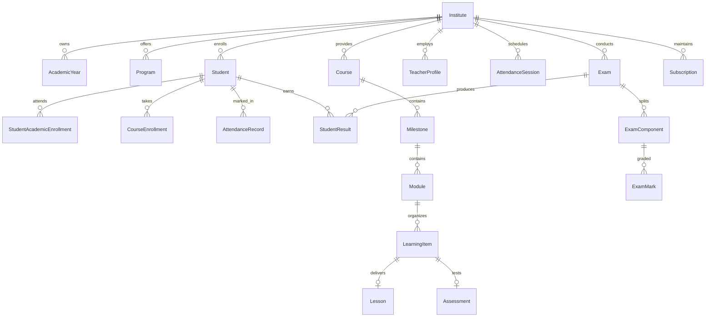

# Education ERP & LMS SaaS Platform – System Architecture & API Catalogue

> **Generated on:** October 2026  
> **Repository:** Education-Platform / prisma-starter  
> **Classification:** Technical Architecture, Domain Model Specification & Comprehensive Endpoint Data Catalogue

---

## 1. System Architecture Overview

### 1.1. Technology Stack
The platform is built as a production-grade, modular multi-tenant backend API utilizing the modern TypeScript / Node.js ecosystem:

* **Runtime & Framework:** Node.js (ES Modules), **Express.js v5.1.0** with strict TypeScript (`tsc`, `tsx`).
* **Database & ORM:** **PostgreSQL** interfaced via **Prisma ORM v7.9.1** (`@prisma/adapter-pg` driver adapter, split schema in `prisma/schema/`).
* **In-Memory & Cache Store:** **Redis v5.11.0** (`src/utils/cache.ts`) handling:
  * JWT Token revocation & blacklisting (`blacklist:<token>`)
  * OTP generation, storage, and verification (`otp:<identifier>`)
  * Dual-layer API Rate Limiting (`rl:api:<ip>`, `rl:auth:<ip>`) with in-memory fallback
* **Realtime Communication:** **Socket.io v4.8.3** (`src/config/socket.ts`, initialized on HTTP server in `src/server.ts`).
* **File Storage & Media:** Multer (local `/uploads` static file server) + Cloudinary SDK (`src/utils/cloudinary.ts`).
* **Input Validation & Security:**
  * **Zod v4.3.6** schema validation middleware on every mutating route.
  * Express Sanitization (`sanitizeRequest`) against parameter pollution and script injection.
  * CORS origin whitelisting & Gzip HTTP response compression (`compression`).
  * Password hashing using `bcryptjs` (salt rounds: 12).
  * Stateless Authentication using `jsonwebtoken` (access token + refresh token rotation).

---

### 1.2. Architectural Pattern & Request Lifecycle

```mermaid
flowchart TD
    Client([Web Client / Mobile App]) -->|HTTP Request| Nginx[Reverse Proxy / Gateway]
    Nginx --> ExpressApp[Express 5 Server: src/app.ts]
    
    subgraph Middlewares [Global Middlewares Pipeline]
        ExpressApp --> Cors[CORS Origin Filter]
        Cors --> Comp[Gzip Compression]
        Comp --> ReqLog[Request Logger: duration & status]
        ReqLog --> Sanitize[Sanitization Middleware]
        Sanitize --> RateLimit[Redis Rate Limiter: General/Auth]
    end

    subgraph Routing [Modular Router: /api/v1]
        RateLimit --> Router[src/modules/routes.ts]
        Router --> AuthMod[/auth]
        Router --> SaasMod[/saas]
        Router --> IdentityMod[/identity]
        Router --> PeopleMod[/people]
        Router --> AcademicMod[/academic]
        Router --> AttendMod[/attendance]
        Router --> LmsMod[/lms]
        Router --> AssessMod[/assessment]
        Router --> PlatMod[/platform]
    end

    subgraph ControllerService [Modular Business Layer]
        Router --> AuthGuard{Auth Middleware<br/>JWT + Redis Blacklist}
        AuthGuard -->|Valid + Role Matched| ValGuard{Zod Validation}
        ValGuard -->|Validated DTO| Controller[Submodule Controller]
        Controller --> Service[Submodule Service]
    end

    subgraph DataPersistence [Data & Storage Layer]
        Service --> PrismaHelper[Prisma Client / PrismaHelper]
        Service --> CacheHelper[Redis Cache Utility]
        Service --> Cloudinary[Cloudinary / Disk Storage]
        PrismaHelper --> Postgres[(PostgreSQL 73 Models)]
        CacheHelper --> Redis[(Redis Cache)]
    end
```

---

### 1.3. Tenancy & RBAC Architecture

1. **Multi-Tenancy Model (Row-Level Isolation):**
   * Tenant Root: The **`Institute`** model is the SaaS tenant container.
   * Scoping Column: Tenant-owned tables contain an explicit `instituteId: String @db.Uuid` foreign key.
   * Child Entities: Aggregates beneath a tenant parent (e.g., `Section` under `ClassGroup`, `LearningItem` under `Course`) inherit tenancy transitively.
   * Platform-level globals: `SubscriptionPlan`, `Permission`, and global `User` accounts exist across institutes.

2. **Dynamic RBAC & Profile Polymorphism:**
   * Global `User` record holds credentials (email, phone, passwordHash, twoFactorEnabled).
   * Tenancy link: `InstituteMembership` connects a `User` to an `Institute` with a specific status (`ACTIVE`, `SUSPENDED`).
   * Dynamic Roles: `Role` is scoped to an `Institute` (`instituteId`, `code`), mapped to atomic `Permission` records (`resource`, `action`) via `RolePermission`.
   * User Personas: A single `User` links to optional 1-to-1 profiles:
     * `Student` (`studentCode`, `admissionDate`, `guardians`)
     * `TeacherProfile` (`employeeCode`, `designation`, routines, live classes)
     * `StaffProfile` (`department`, `designation`)
     * `Guardian` (`relationship`, linked students)

---

## 2. Business Domains & Data Models (73 Prisma Models)



### Domain Breakdown:

| # | Domain Schema File | Models Included | Business Scope & Core Functionality |
|---|---|---|---|
| **1** | [`saas.prisma`](file:///e:/Anar/PR/Education-Platform/prisma-starter/prisma/schema/saas.prisma) | `Institute`, `InstituteSetting`, `SubscriptionPlan`, `Subscription`, `SubscriptionPayment` | Organization onboarding, subdomain/slug configuration, branding, subscription tier management, SaaS billing cycles, and payments. |
| **2** | [`identity.prisma`](file:///e:/Anar/PR/Education-Platform/prisma-starter/prisma/schema/identity.prisma) | `User`, `Role`, `Permission`, `RolePermission`, `UserRole`, `InstituteMembership` | Authentication credentials, 2FA status, institute memberships, customizable per-tenant roles, and fine-grained resource-action permission matrix. |
| **3** | [`people.prisma`](file:///e:/Anar/PR/Education-Platform/prisma-starter/prisma/schema/people.prisma) | `Student`, `Guardian`, `StudentGuardian`, `TeacherProfile`, `StaffProfile` | Comprehensive stakeholder demographic records, student admissions, guardian linkages, teacher employment profiles, and staff assignments. |
| **4** | [`academic.prisma`](file:///e:/Anar/PR/Education-Platform/prisma-starter/prisma/schema/academic.prisma) | `AcademicYear`, `Program`, `Level`, `ClassGroup`, `Section`, `Subject`, `StudentAcademicEnrollment`, `ClassTeacher` | Academic taxonomy: academic calendars, degrees/curricula, grade levels, class divisions, sections, subject catalogues, and year-by-year cohort enrollment. |
| **5** | [`attendance_routine.prisma`](file:///e:/Anar/PR/Education-Platform/prisma-starter/prisma/schema/attendance_routine.prisma) | `AttendancePolicy`, `AttendanceCalendar`, `AttendanceCalendarRule`, `AttendanceCalendarException`, `AttendanceSession`, `AttendanceRecord`, `ClassRoutine`, `LiveClass` | Configurable attendance weighting, working calendars & holidays, daily session tracking, student attendance records (Present/Late/Absent), weekly timetable routines, and Zoom/Meet live class integrations. |
| **6** | [`lms.prisma`](file:///e:/Anar/PR/Education-Platform/prisma-starter/prisma/schema/lms.prisma) | `Course`, `CourseTeacher`, `CourseEnrollment`, `CourseAccessRestriction`, `CourseBundle`, `CourseBundleItem`, `Milestone`, `Module`, `LearningItem`, `LearningItemPrerequisite`, `LearningItemAccessOverride`, `Lesson`, `LessonVideo`, `LessonResource`, `LessonNote`, `MilestoneProgress`, `ModuleProgress`, `LearningItemProgress`, `LessonProgress` | Complete online learning suite: hierarchical curriculum (Milestone → Module → Learning Item → Lesson/Assessment), course enrollment & access gating, prerequisites, video streaming metadata, downloadable resources, student private notes, and fine-grained progress tracking. |
| **7** | [`assessment.prisma`](file:///e:/Anar/PR/Education-Platform/prisma-starter/prisma/schema/assessment.prisma) | `MarkingScheme`, `MarkingComponent`, `MarkingSchemeAssignment`, `Assessment`, `QuizQuestion`, `AssessmentResult`, `Assignment`, `AssignmentSubmission`, `Exam`, `ExamComponent`, `ExamMark`, `StudentResult`, `ResultComponent`, `GradingSystem`, `GradeRule` | Dynamic multi-criteria evaluation engine: weighted marking schemes, quizzes with automated grading, student assignments & file submissions, term exams, component marks, GPA/grade rule conversion tables, and final published student results. |
| **8** | [`platform.prisma`](file:///e:/Anar/PR/Education-Platform/prisma-starter/prisma/schema/platform.prisma) | `Notice`, `NoticeAudience`, `Notification`, `FileAsset`, `CertificateTemplate`, `Certificate`, `AuditLog` | Institutional bulletin notices with audience targeting, user notifications (in-app, email, SMS), secure file asset registry, verifiable digital certificate generation (with QR and verification codes), and system audit logging. |

---

## 3. Comprehensive Route & Data Catalogue ("কোন Route কি Data দিতেছে")

All endpoints are registered under the global prefix: **`/api/v1`**.

---

### 3.1. Authentication & System Health (`/auth`, `/health`)

| Method | Full Endpoint Path | Guard / Middleware | Inputs (Params / Body) | Data Returned by Route |
|---|---|---|---|---|
| `GET` | `/api/v1/health` | Public | None | Server uptime, status (`"online"`), environment, and ISO timestamp. |
| `POST` | `/api/v1/auth/register` | Rate Limiter, Zod Validation | Body: `email`, `password`, `firstName`, `lastName`, `phone` | Newly created `User` record (id, email, names, avatarUrl, status: `INVITED`/`ACTIVE`). |
| `POST` | `/api/v1/auth/login` | Rate Limiter, Zod Validation | Body: `email` or `phone`, `password` | `{ accessToken, refreshToken, user: { id, email, role, roles, memberships } }`. Updates `lastLoginAt`. |
| `POST` | `/api/v1/auth/refresh-token` | Zod Validation | Body: `refreshToken` | New `{ accessToken }` signed with updated session payload. |
| `POST` | `/api/v1/auth/logout` | `auth()` (Authenticated) | Bearer Token in Header | Success response. Token is added to Redis blacklist (`blacklist:<token>`) with TTL. |
| `POST` | `/api/v1/auth/send-otp` | Rate Limiter, Zod Validation | Body: `identifier` (email/phone) | Stores generated 6-digit OTP in Redis (`otp:<identifier>`, TTL: 300s). Returns confirmation message. |
| `POST` | `/api/v1/auth/verify-otp` | Zod Validation | Body: `identifier`, `otp` | Validates against Redis; returns verification status boolean. |
| `POST` | `/api/v1/auth/forgot-password` | Rate Limiter, Zod Validation | Body: `email` | Generates reset token with 1h TTL, dispatches password reset email. |
| `POST` | `/api/v1/auth/reset-password` | Rate Limiter, Zod Validation | Body: `token`, `newPassword` | Updates `passwordHash` in DB, invalidates reset token. |
| `POST` | `/api/v1/auth/change-password`| `auth()` | Body: `oldPassword`, `newPassword` | Verifies existing password and updates to new hash. |
| `GET` | `/api/v1/auth/me` | `auth()` | Bearer Token | Authenticated `User` details, active roles, and institute memberships. |

---

### 3.2. SaaS & Tenant Administration (`/saas`)

#### Institutes (`/api/v1/saas/institutes`)
* `POST /`: Creates `Institute` record, initializes default `InstituteSetting`. Returns created institute.
* `GET /`: Paginated list of institutes with filters (`searchTerm`, `status`, `country`, `division`, `district`). Includes `settings`, `subscription`, and `_count` (`students`, `teachers`, `courses`, `academicYears`).
* `GET /:id`: Full single institute record with nested `settings`, active `subscription` (with plan details), and entity count summaries.
* `GET /:id/stats`: **Analytics Endpoint** returning high-level institutional metrics:
  ```json
  {
    "studentsCount": 1250,
    "teachersCount": 45,
    "coursesCount": 18,
    "activeEnrollments": 1180,
    "todaySessions": 24
  }
  ```
* `PATCH /:id`: Updates institutional profile data (name, contact, address, logo, currency, timezone).
* `PATCH /:id/settings`: Upserts `InstituteSetting` (academic terms, grading rules, LMS access defaults).
* `DELETE /:id`: Deletes institute (cascades child records).

#### Subscriptions (`/api/v1/saas/subscriptions`)
* `POST /plans`: Creates SaaS `SubscriptionPlan` (name, code, price, limits for students, storage, features).
* `GET /plans`: Lists all available active subscription plans.
* `POST /`: Enrolls an institute into a `Subscription` (sets `startedAt`, `trialEndsAt`, `billingCycle`).
* `GET /`: Lists active and expired subscriptions across institutes.
* `POST /payments`: Logs a `SubscriptionPayment` (amount, payment method, transactionId, status).

---

### 3.3. Identity, Users & Dynamic RBAC (`/identity`)

#### Users (`/api/v1/identity/users`)
* `GET /`: Paginated search across `User` records with filters (`status`, `searchTerm`). Returns user profiles.
* `GET /:id`: Single user profile with linked `memberships`, `roles`, and polymorphic profile relations (`student`, `teacher`, `staff`, `guardian`).
* `PATCH /:id`: Updates user basic details (firstName, lastName, phone, avatarUrl).
* `DELETE /:id`: Soft or hard deletes user account.
* `POST /:id/roles`: Assigns `Role` to user via `UserRole` junction table.

#### Roles & Permissions (`/api/v1/identity/roles`, `/api/v1/identity/permissions`)
* `POST /roles`: Creates an institute-scoped `Role` (`instituteId`, `name`, `code`).
* `GET /roles`: Lists roles for an institute with their associated permissions.
* `POST /roles/:id/permissions`: Maps permissions to role via `RolePermission` entries.
* `GET /permissions`: System-wide registry of atomic permissions (resource + action).

---

### 3.4. People & Demographics (`/people`)

#### Students (`/api/v1/people/students`)
* `POST /`: Registers a `Student` with demographic info, blood group, admission number, and links to `User`.
* `GET /`: Paginated query of students with filtering by `instituteId`, `status`, `gender`, `studentCode`.
* `GET /:id`: Deep profile view including `user`, `guardians`, current `academicEnrollments`, `courseEnrollments`, and `certificates`.
* `GET /:id/stats`: **Student Performance & Attendance Stats**:
  ```json
  {
    "totalSessions": 120,
    "presentRecords": 108,
    "attendancePercent": 90.00,
    "enrolledCourses": 6,
    "recentResults": [ { "exam": "Mid-Term", "subject": "Mathematics", "grade": "A+" } ]
  }
  ```
* `PATCH /:id`: Updates student bio and emergency contact details.
* `DELETE /:id`: Removes student profile.

#### Teachers (`/api/v1/people/teachers`)
* `POST /`: Creates `TeacherProfile` with `employeeCode`, `designation`, linked to `User` and `Institute`.
* `GET /`: Lists teachers with filtering by employment status and department.
* `GET /:id`: Teacher details including class assignments (`ClassTeacher`), course assignments (`CourseTeacher`), and class routine schedules.
* `PATCH /:id`: Updates teacher employment record.

#### Staff & Guardians (`/api/v1/people/staff`, `/api/v1/people/guardians`)
* Provides standard CRUD endpoints for non-teaching staff and parent/guardian accounts, including `StudentGuardian` family relationship mappings.

---

### 3.5. Academic Taxonomy & Cohorts (`/academic`)

| Base Route | Endpoints | Data Returned / Action Performed |
|---|---|---|
| `/years` | `POST`, `GET`, `GET /:id`, `PATCH /:id` | Academic session configurations (name, code, startDate, endDate, `isCurrent` flag). |
| `/programs` | `POST`, `GET`, `GET /:id`, `PATCH /:id` | Program definitions (e.g., High School, B.Sc. in Computer Science). |
| `/levels` | `POST`, `GET`, `GET /:id`, `PATCH /:id` | Grade levels within programs (e.g., Grade 9, Semester 1). |
| `/classes` | `POST`, `GET`, `GET /:id`, `PATCH /:id` | Cohort classes linked to an academic year (`ClassGroup`). |
| `/sections` | `POST`, `GET`, `GET /:id`, `PATCH /:id` | Sub-sections within classes (e.g., Section A, Section B, capacity). |
| `/subjects` | `POST`, `GET`, `GET /:id`, `PATCH /:id` | Subject catalogue (subject name, subject code, credit hours, pass mark). |
| `/enrollments` | `POST`, `GET`, `GET /:id`, `PATCH /:id` | Student academic placement linking `studentId`, `academicYearId`, `classGroupId`, and `sectionId` with `rollNumber`. |

---

### 3.6. Attendance, Routines & Live Classes (`/attendance`)

| Base Route | Endpoints | Data Returned / Action Performed |
|---|---|---|
| `/policies` | `POST`, `GET`, `GET /:id`, `PATCH /:id` | Minimum attendance thresholds (e.g., 75%), status weights (Present = 1.0, Late = 0.75, HalfDay = 0.5), late-penalty ratios. |
| `/calendars` | `POST`, `GET`, `GET /:id`, `PATCH /:id` | Working day calendars, weekly recurrence rules, and holiday exception dates. |
| `/sessions` | `POST`, `GET`, `GET /:id`, `PATCH /:id` | **Attendance Sessions**: Created per date/class/subject. Stores session status (`OPEN`, `COMPLETED`). |
| `/sessions/:id/records` | `POST`, `GET`, `PATCH` | Bulk logs individual student attendance records (`PRESENT`, `ABSENT`, `LATE`, `EXCUSED`, `HALFDAY`, remarks). |
| `/routines` | `POST`, `GET`, `GET /:id`, `PATCH /:id` | Weekly timetable entries (`dayOfWeek`, `startTime`, `endTime`, `teacherId`, `subjectId`, `room`). |
| `/live-classes` | `POST`, `GET`, `GET /:id`, `PATCH /:id` | Scheduled online classes with Zoom/Google Meet links, start/end times, and recording URLs. |

---

### 3.7. LMS & Digital Learning Suite (`/lms`)

#### Courses (`/api/v1/lms/courses`)
* `POST /`: Creates course with title, code, slug, thumbnail, price, and visibility (`isPublic`, `DRAFT`/`PUBLISHED`).
* `GET /`: Paginated courses list with search, institute, subject, and status filters.
* `GET /:id`: Full structured syllabus hierarchy:
  * Milestones → Modules → Learning Items → (Lessons + Videos + Resources / Assessments).
* `GET /:id/stats`: **Course Enrollment & Completion Analytics**:
  ```json
  {
    "totalStudents": 450,
    "activeStudents": 390,
    "completedStudents": 48,
    "bannedStudents": 12,
    "completionRate": 10.67
  }
  ```
* `PATCH /:id`, `DELETE /:id`: Manages course lifecycle.

#### Curriculum Components (`/milestones`, `/modules`, `/learning-items`, `/lessons`)
* **Milestones & Modules:** Create and order structured chapters within courses.
* **Learning Items:** Polymorphic units (`LESSON`, `ASSESSMENT`, `RESOURCE`) with prerequisite rules.
  * `GET /learning-items/:id/access`: Evaluates whether a student has unlocked an item (prerequisites met, enrollment valid, overrides applied).
* **Lessons & Media:**
  * `POST /videos`: Attaches video stream metadata (provider: `CLOUDINARY`/`YOUTUBE`/`S3`, duration, resolution).
  * `POST /notes`: Student private note taking (`studentId`, `lessonId`, note text, timestamp).

#### Course Enrollments & Progress Tracking (`/api/v1/lms/enrollments`)
* `POST /`: Enrolls student in course (`ACTIVE`, `COMPLETED`, `BANNED`, `SUSPENDED`).
* `GET /:id/progress`: Calculates student completion percentage across items, modules, and milestones.
* `POST /learning-items/:id/progress`: Updates item progress (`NOT_STARTED`, `IN_PROGRESS`, `COMPLETED`, `watchedSeconds`, `score`).
* `POST /lessons/:id/progress`: Upserts `LessonProgress` record with exact video playback position (`lastPositionSec`) and completion flag.

---

### 3.8. Assessments, Exams & Results (`/assessment`)

| Base Route | Endpoints | Data Returned / Action Performed |
|---|---|---|
| `/marking-schemes` | `POST`, `GET`, `GET /:id`, `PATCH /:id` | Flexible weight structures (e.g. 30% Mid, 50% Final, 10% Attendance, 10% Quiz). Includes `MarkingComponent` entries. |
| `/assessments` | `POST`, `GET`, `GET /:id`, `PATCH /:id` | Quizzes and assignments tied to courses or subjects. |
| `/assessments/:id/questions` | `POST`, `GET` | Quiz questions with question type (`MCQ`, `DESCRIPTIVE`), options, marks, and explanation. |
| `/assessments/:id/submit` | `POST` | Submits quiz answers; auto-evaluates MCQ responses and creates `AssessmentResult` (`score`, `totalMarks`, `percentage`). |
| `/assessments/:id/submissions` | `POST`, `GET` | Handles file assignment uploads and teacher feedback/grading (`AssignmentSubmission`). |
| `/exams` | `POST`, `GET`, `GET /:id`, `PATCH /:id` | Institutional term exams linked to academic years and terms. |
| `/exams/:id/components` | `POST`, `GET` | Subject-level exam components (e.g., Paper 1 Theory, Paper 2 Practical). |
| `/exams/components/:id/marks` | `POST`, `GET` | Records student raw exam scores (`ExamMark`). |
| `/results` | `POST /publish`, `GET` | Aggregates exam marks + continuous assessments to publish official `StudentResult` records (`gpa`, `grade`, `rank`, `totalMarks`). |
| `/grading-systems` | `POST`, `GET`, `GET /:id` | Grade boundary conversion rules (e.g. 80-100% = A+, GPA 4.00; 70-79% = A, GPA 3.50). |

---

### 3.9. Platform Services (`/platform`)

| Base Route | Endpoints | Data Returned / Action Performed |
|---|---|---|
| `/notices` | `POST`, `GET`, `GET /:id`, `PATCH /:id`, `DELETE /:id` | Broadcast announcements with priority, publishing window, and targeted audiences (`ALL`, `STUDENTS`, `TEACHERS`, `SPECIFIC_CLASS`). |
| `/notifications` | `POST`, `GET`, `GET /:id`, `PATCH /:id/read`, `DELETE /:id` | Manages user in-app and email notifications (`isRead`, `channel`, `type`, `metadata`). |
| `/files` | `POST /upload`, `GET`, `GET /:id`, `DELETE /:id` | Multi-format file uploader (PDF, Images, Documents). Creates `FileAsset` with size, mime-type, and Cloudinary/storage URL. |
| `/certificates` | `POST`, `GET`, `GET /:id`, `GET /verify/:code` | Generates student graduation/completion certificates (`certificateNo`, `verificationCode`, `pdfUrl`, `qrCodeUrl`). Provides public verification endpoint. |

---

## 4. Current Gaps & Missing Domains

| Capability / Module | In Schema? | In API Routes? | Current Status & Technical Reality |
|---|---|---|---|
| **Student Fee & Invoicing** | **NO** | **NO** | MISSING: Student tuition fee schedules, invoice generation, discount/scholarship, late fines, and collection ledger. |
| **HR & Payroll** | **NO** | **NO** | MISSING: Staff payroll slips, salary structures, leave requests, and provident fund calculations. |
| **Library Management** | **NO** | **NO** | MISSING: Book catalogue, barcode indexing, book loans, overdue fines, and return tracking. |
| **Physical Assets & Transport**| **NO** | **NO** | MISSING: Campus inventory, vehicle maintenance, route stops, and transport passenger assignments. |
| **BullMQ Async Workers** | **NO** | **NO** | STUB ONLY: `src/jobs/queues/index.ts` and `src/jobs/workers/index.ts` export empty `{}` objects. No background workers or retry queues are running. |
| **Cron Scheduling** | **NO** | **NO** | MISSING: No scheduled tasks for daily attendance rollups, subscription expiration notices, or report materializations. |
| **System Audit Logging** | **Partial (Model only)**| **NO** | UNWIRED: `AuditLog` table exists in PostgreSQL, but 0 services or middlewares write audit entries when records change. |
| **Analytics Event Pipeline** | **NO** | **NO** | MISSING: No `AnalyticsEvent` streaming table exists for clickstream, video heartbeat, or drop-off telemetry. |

---

## 5. Architectural Recommendations

1. **Implement Dedicated Analytics Rollup Views:**
   * Heavy aggregation queries currently run directly on PostgreSQL tables. Daily rollups (e.g. `daily_attendance_summary`, `course_progress_summary`) should be materialized in Redis or PostgreSQL summary tables.
2. **Wire the `AuditLog` Middleware:**
   * Attach audit hooks to critical mutating operations (Exam Mark alterations, Result Publishing, Role changes) to utilize the existing `AuditLog` model.
3. **Activate BullMQ Background Workers:**
   * Connect Redis to BullMQ for asynchronous PDF certificate rendering, bulk notification dispatches, and async report exports.
